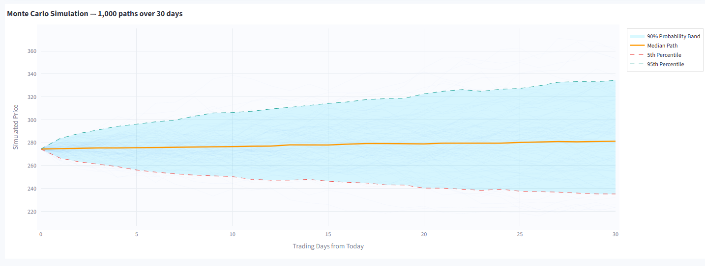

# Stock Analysis Dashboard

An educational Streamlit project for exploring daily OHLCV data, statistical indicators, and simple forecasting methods.



## Run locally

Use Python 3.14. The pinned dependencies were tested with Python 3.14.10.

```powershell
git clone https://github.com/AdvayV/P-S-Project.git
cd P-S-Project
python -m venv .venv
.\.venv\Scripts\python.exe -m pip install -r requirements.txt
.\.venv\Scripts\python.exe -m streamlit run main.py
```

Open [the local dashboard](http://localhost:8501). On macOS or Linux, use `.venv/bin/python` in place of `.\.venv\Scripts\python.exe`.

## Try the included data

1. Open **CSV Analysis** and upload [GOOGL_5y_1d.csv](GOOGL_5y_1d.csv) as Stock 1.
2. Open **ML Prediction**. Compare the regression and persistence RMSE on the chronological holdout. The forecast is labeled with the latest date in the uploaded file.
3. Open **Monte Carlo**, choose a horizon, and generate simulated paths. **Anomaly Detection** flags unusual combinations of features with Isolation Forest.

The CSV path runs without a market-data connection. The quote viewer and optional `python -m streamlit run generate_csv.py` downloader use Yahoo Finance. Freshness and coverage depend on the provider and requested interval.

## Forecast evaluation

- Each input row represents the end of a recorded session. The training target is the next recorded close. Rolling indicators use the current and earlier rows.
- Regression trains on earlier data and scores a later holdout. Persistence predicts the next close will equal the input row's close. Both RMSE values use the same target sessions and are expressed in price units.
- After evaluation, a new fit uses all known input-target pairs to estimate the next session after the latest uploaded row. The app reports the latest observation's date. Use a CSV with one complete row per session in the period being studied. Rows with invalid dates or missing required prices may be filtered before evaluation.
- R² describes holdout fit on price levels. The comparison with persistence is more informative about whether the model adds predictive value in that sample.

On the checked-in GOOGL sample with a 20% holdout, regression RMSE is **4.59** and persistence RMSE is **4.44** in the file's price units. Regression has an R² of **0.9947** and a higher error than persistence on this sample.

Monte Carlo results describe outcomes under the simulation assumptions. The dashboard is for educational analysis. Historical errors and simulated quantiles cannot establish future returns.

## Input and checks

Provide one row per daily session with `Date` in YYYY-MM-DD format and numeric `Open`, `High`, `Low`, and `Close`. `Volume` is optional. Use the supplied sample for the first run.

```powershell
.\.venv\Scripts\python.exe -m unittest discover -s tests -v
```

`main.py` is the supported dashboard entry point. `forecasting.py` implements the forecast and evaluation, and `tabs/` contains the dashboard panels. [Project documentation](DOCUMENTATION.md) and the [LaTeX write-up](research_paper.tex) describe the original coursework. `code.py` is the legacy monolithic snapshot.
